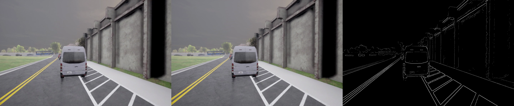
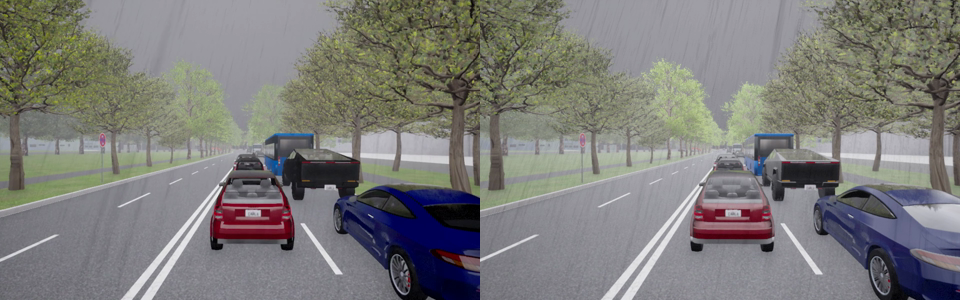

# Test report: 6 variants and 1 base scenario on both map families

7 November 2026. Every scenario was run once with `scripts/run_osc.py`, recording all 8 EDGAR views
plus their 8 edge views, and compared with the original munich2drive camera clip of the same name.

## Setup

| | |
|---|---|
| GPU | one NVIDIA RTX 5090 (32 GB), two CARLA servers on it at the same time |
| Servers | Munich server v5 (port 4110) and Bay Area server v1 (port 4100), started with `scripts/start_carla.sh` |
| ScenarioRunner | stock 0.9.16 (tag `v0.9.16`, commit 94ff3b8), Python 3.10, CARLA client 0.9.16 |
| Scenario files | exported by munich2drive-openscenario, identical to the published sets |
| Runner | `run_osc.py` (it runs ScenarioRunner with `--sync --frameRate 10`); Munich runs also with `--lamp-bridge` |

## Scenarios

| Scenario | Map | Traffic | Weather | Agents | Removed during the run |
|---|---|---|---|---|---|
| scenario_00_ego_6938 | Munich_Route_1 | light | WetCloudyNoon | 119 | 0 |
| scenario_02_ego_7937 | Munich_Route_1 | dense | WetCloudySunset | 189 | 0 |
| scenario_02_ego_6944 | Munich_Route_1 | dense | HardRainNoon | 83 | 2 |
| scenario_00_ego_5105 | Page_Mill_Rd_Palo_Alto_CA | light | CloudySunset | 177 | 1 |
| scenario_00_ego_1470 | Yale_St_Palo_Alto_CA | light | HardRainNoon | 186 | 8 |
| scenario_00_ego_1585 | Belmont_Office_Park_Belmont_CA | light | ClearSunset | 138 | 14 |
| scenario_00 (base, no ego) | Belmont_Office_Park_Belmont_CA | light | – | 138 | 14 |

## Results

| Scenario | Agents in the run | Spawns refused / recovered / lost | Colours as in the file | Frames per view | Worst position error | PSNR | SSIM | Run time |
|---|---|---|---|---|---|---|---|---|
| scenario_00_ego_6938 | 119 / 119 | 4 / 4 / 0 | 116 / 116 | 200, none missed | 1.4 mm | 28.1 dB | 0.938 | 12.7 min |
| scenario_02_ego_7937 | 189 / 189 | 0 / 0 / 0 | 183 / 183 | 200, none missed | 0.4 mm | 37.9 dB | 0.966 | 7.9 min |
| scenario_02_ego_6944 | 83 / 83 | 48 / 48 / 0 | 80 / 80 | 200, none missed | 0.7 mm | 23.6 dB | 0.897 | 11.4 min |
| scenario_00_ego_5105 | 177 / 177 | 11 / 11 / 0 | 166 / 166 | 200, none missed | 0.2 mm | 38.0 dB | 0.980 | 9.0 min |
| scenario_00_ego_1470 | 186 / 186 | 9 / 9 / 0 | 181 / 181 | 200, none missed | 0.2 mm | 39.3 dB | 0.961 | 4.4 min |
| scenario_00_ego_1585 | 138 / 138 | 6 / 6 / 0 | 136 / 136 | 200, none missed | < 0.1 mm | 41.3 dB | 0.977 | 7.5 min |
| scenario_00 (base) | 138 / 138 | 6 / 6 / 0 | 136 / 136 | no cameras | < 0.1 mm | – | – | 0.4 min |

How to read the columns:

- **Agents, spawns:** every run had every agent of its file. "Refused" are agents CARLA would not spawn
  at their pose; `run_osc.py` spawned all of them again.
- **Colours:** the colour in the file is the clip's; agents without one (two-wheelers) are not counted.
- **Frames:** every view has 200 frames, and every frame was the image of exactly that tick.
- **Position error:** the worst distance, over all actors and all 200 frames, between an actor's
  reference point (the ego's bounding-box centre, every other vehicle's origin) and the file's
  trajectory. Every actor's height was within 0.1 mm of its placement.
- **Removals:** no removed agent was visible after its removal time.
- **Munich lamps:** the 640 German lamp heads were switched dark before t = 0, as in the clips.
- **PSNR and SSIM:** the mean over the 8 views, run against the original clip, frame by frame.

## Why the videos still differ from the clips

Every agent stands where the clip had it, to the millimetre. The remaining differences come from
CARLA's rendering, which is not deterministic between two runs:

- **rain:** rain streaks and wet-road reflections are drawn randomly. The two `HardRainNoon` clips
  differ the most: scenario_02_ego_6944 reaches 20.5 dB on its front view, where the rain falls in
  front of the camera;
- **wind:** vegetation sways in real time;
- **camera effects:** lens flare and temporal anti-aliasing;
- **traffic lights:** in the clips they followed the scenarios' signal plans; in a re-run they run
  CARLA's own cycles. In Munich, the German lamp heads at signalised junctions were lit in the clips
  and stay dark in a re-run.

*Page Mill scenario_00_ego_5105, front view, frame 120: the original clip, the re-run, and the edge
view of the re-run.*

*Munich scenario_02_ego_6944 (`HardRainNoon`), front view, frame 150: the original clip and the re-run.
The vehicles match; the rain differs.*

## Plain ScenarioRunner

`scenario_runner.py` alone, on scenario_00_ego_1470: CARLA refused 9 of the 186 agents at spawn, and
ScenarioRunner aborted the scenario at load ("Cannot find actor") because one of them is removed later
in the file. On the Belmont files, plain ScenarioRunner was killed while building its route planner.
Both are why the repository runs ScenarioRunner through `run_osc.py`.

## Issues found by the test and fixed

| Issue | Effect before the fix |
|---|---|
| ScenarioRunner ignores a storyboard `StopTrigger` that is not a criterion | a run continued after its 20 s until ScenarioRunner's 60 s timeout |
| ScenarioRunner starts a `SimulationTimeCondition`'s clock when its event starts | removed agents stayed visible 0.2 s too long |
| CARLA's route planner loops on 3 Belmont road segments | ScenarioRunner was killed on every Belmont file |
| a controller's `set_transform` is asynchronous | once in ~37,000 actor-frames a car showed its previous position (0.8 m) |
| ScenarioRunner applies the weather only after the actors spawn | frames 0 and 1 had the previous run's weather |
| the ego's height and pitch were taken at the footprint centre | camera heights up to 14 cm off on slopes |
| traffic models were placed by box centre, not origin | ambulances and tourismo buses 0.2–0.3 m off the clip |

The last four fixes raised the comparison with the clips. "Before" is the first runner version,
"after" the final one; same scenarios, same servers:

| Scenario | PSNR / SSIM before | after |
|---|---|---|
| scenario_00_ego_6938 | 26.8 dB / 0.886 | 28.1 dB / 0.938 |
| scenario_02_ego_7937 | 32.4 dB / 0.929 | 37.9 dB / 0.966 |
| scenario_00_ego_5105 | 32.7 dB / 0.976 | 38.0 dB / 0.980 |
| scenario_00_ego_1470 | 32.6 dB / 0.925 | 39.3 dB / 0.961 |
| scenario_00_ego_1585 | 29.4 dB / 0.911 | 41.3 dB / 0.977 |
